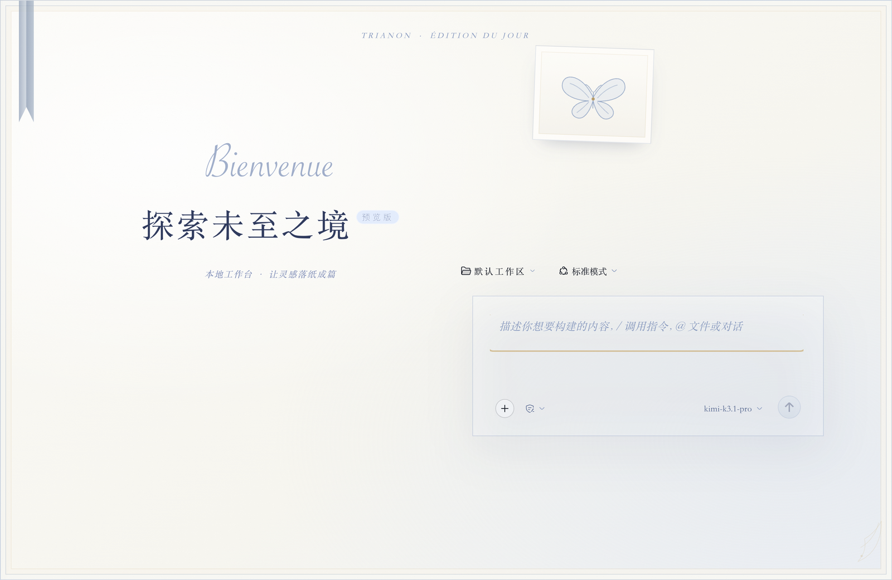
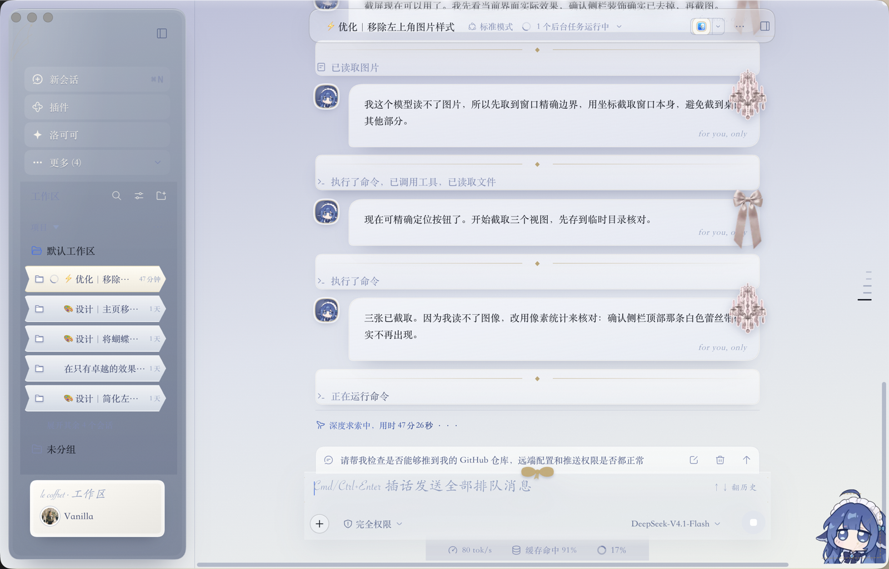
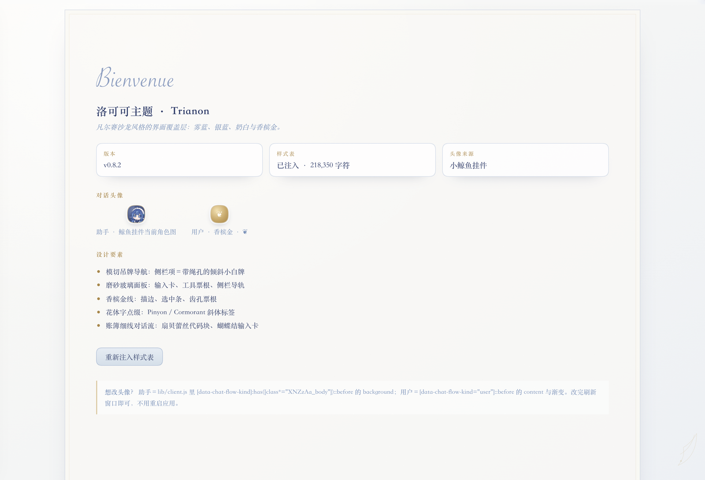

# dsh-rococo-theme

把 DeepSeek Harness 的 Web GUI 换成洛可可沙龙风格（雾蓝 / 银蓝 / 奶白 / 香槟金）。采用模切吊牌、磨砂玻璃、香槟金线与花体字点缀，营造精致柔和的纸面质感。

A Rococo visual theme for the DSH Web GUI: misty blue, silver and ivory surfaces with champagne-gold hairlines, die-cut hang-tag navigation, frosted panels, scalloped lace code blocks and an engraved ledger conversation flow. Light and dark palettes follow the app theme automatically.

纯浏览器端主题插件：不注册聊天槽位、不改任何功能，`apply()` 时向 `<head>` 注入一份 CSS 覆盖层，并在侧栏注册一个「洛可可」说明面板。

---

## 截图 / Screenshots

| 主页 hero | 对话流 |
|---|---|
|  |  |

侧栏「洛可可」面板：



---

## 安装 / Install

```bash
# 从 GitHub 安装
dsh plugin --profile desktop add github:chenglixue66-dotcom/dsh-rococo-theme

# 或从本地目录安装
dsh plugin --profile desktop add link:/absolute/path/to/dsh-rococo-theme
```

装完刷新窗口（⌘R）即可，不必重启应用：插件 bundle 按内容哈希寻址，改动后刷新就换新。

## 卸载 / Uninstall

移除 profile `package.json` 里的 dependency 与 bundles 条目，重启 DSH。

---

## 它做了什么 / What it does

- **只改外观**：全部行为是一份 CSS 覆盖层，没有宿主能力、没有网络请求、不注册对话槽位。
- **深浅色自动切换**：浅色「凡尔赛晨厅」与深色「夜曲」两套值，跟随应用主题。
- **侧栏面板**：侧栏出现「洛可可」一行，点开是主题说明页——版本、样式表状态（已注入字符数）、两个对话头像的实时预览、设计要素清单，以及一个「重新注入样式表」按钮。
- **对话头像**：助手与用户消息的圆形徽章由本主题绘制（见下方「头像」）。
- **Bienvenue 纸面**：主页采用双线纸框、缎带书签、蝴蝶版画与左花体标题／右侧输入卡的构图；个人设置页和「洛可可」面板共用这套纸面语言。

## 组件清单 / Components（v0.8.2）

| 组件 | 位置 | 效果 |
|---|---|---|
| 模切吊牌导航 | 侧栏面板项 | 绳轨（垂直香槟绳）+ 短绳穿牌孔 + 模切白边 + 交替微倾 + 弹簧动画，选中态香槟竖条 |
| 磨砂玻璃输入卡 | 对话页底部 | frosted blur + 双层描金 + 四角卷草点 + 顶部蝴蝶结（悬停摆头） |
| 蕾丝冠输入卡 | 主页 hero 输入卡 | 顶部一排扇贝金半圆（仅主页） |
| 花体占位符 | 输入框 placeholder | 铜板手写体（Pinyon/Savoye/Snell 回退栈），雾蓝色 |
| 火漆小牌 | 模型/权限 chips | 金边胶囊，选中态鎏金填充 |
| 账簿对话流 | 消息流 | 34px 细金横线随内容滚动 + 22px 竖栏金线固定不动 |
| 对话头像徽章 | 每条消息 | 32px 圆形：助手＝鲸鱼图（取挂件当前角色图，缺失时回退雾蓝渐变），用户＝香槟金 ❦ |
| 回合分隔 | 消息之间 | 香槟发丝线 + 双菱花 |
| 卷宗票根 | 工具调用卡片 | mask 真打孔月牙缺口（左右）+ 存根联（香槟 wash + 齿孔虚线）+ 悬停抽票感 |
| 鎏金尾注 | 用量统计 | Cormorant 斜体 + 菱花前缀 |
| 羊皮信笺 | 引用块 | 双金线边 + ❝ 花饰 + 香槟蜡封角 |
| 邮票齿框 | 图片 | 模切白边相框 + 内缘虚线齿孔 + 微倾斜 |
| 鎏金牌 | 代码块横幅 / 表头 | 香槟 wash + small-caps |
| 终端票根 | dockkit 页签 | 梯形票根 + 圆角金边 |
| 徽章水印 | 主页中央 | 洛可可椭圆双环 + 卷草纹 + 蝴蝶结（仅空会话态浮现） |
| 勋章鱼徽 | 主页品牌标 | 珍珠白章体 + 双层香槟环 + 悬停旋转 |
| 鎏金标题 | 主页标题 | 五段香槟渐变 small-caps |
| 卷草角饰 + 纸颗粒 | 全局 | 四角淡金卷草 SVG + feTurbulence 纸感 |
| 香槟滚动条/焦点环/光标 | 全局 | thin champagne scrollbar、`:focus-visible` 金环、caret 香槟色 |

## 头像 / Avatars

两条消息的徽章都是主题用伪元素画的 32×32 圆，不是 DSH 自带组件：

- **助手**：`background` 第一层是 `url("/dsh-whale/image.png")`——即 dsh-whale-widget 挂件当前角色图的同源地址，换角色图头像会跟着换；**没装那个挂件时图片加载失败，自动回退到雾蓝渐变圆**，不会出现破图。
- **用户**：香槟金径向渐变 + `❦` 字形。

改法（都在 `lib/client.js` 的 CSS 模板里）：

```css
/* 助手 */
[data-chat-flow-kind]:has([class*="XNZzAa_body"])::before { background: url("…") center/cover no-repeat, radial-gradient(…); }
/* 用户 */
[data-chat-flow-kind="user"]::before { content: "❦"; background: radial-gradient(…); }
```

改完刷新窗口即可。若要把助手头像换成本地图片，推荐内联 `data:` URI，这样不依赖任何其他插件。

## 设计令牌 / Design tokens（`--tri-*`）

| 令牌 | 值 | 用途 |
|---|---|---|
| `--tri-ivory` | `#FBFAF6` | 奶白纸面 |
| `--tri-fog` | `#7C93BA` | 雾蓝点缀 |
| `--tri-ink` | `#2E3B68` | 墨蓝正文 |
| `--tri-champ` | `#C7A86A` | 香槟金主线 |
| `--tri-champ-l` | `#E9D7A8` | 浅香槟（高光/选中条） |
| `--tri-champ-d` | `#A8874A` | 深香槟（文字/图标） |
| `--tri-spring` | `cubic-bezier(.22,1.3,.36,1)` | 弹簧动画 |
| `--tri-serif` | Playfair / 宋体栈 | 标题正文 |
| `--tri-corm` | Cormorant 栈 | 斜体尾注/引用 |
| `--tri-script` | Pinyon / 花体栈 | 占位符 |
| `--tri-mono` | JetBrains Mono 栈 | 代码/终端 |

## 自定义 / Customizing

- **改配色**：全局替换 `--tri-champ`，或改 `body:not([data-ds-dark-theme])` 变量块。
- **关某个装饰**：按组件清单注释对应区块（CSS 分节编号 ①—⑧）。
- **回滚版本**：用 `snapshots/` 里的 CSS 替换 `lib/client.js` 中模板字符串内容。
- **深浅色**：跟随 DSH 主题设置自动切换，无需配置。

## 文件结构 / Layout

```
dsh-rococo-theme/
├── package.json            # dsh.bundle.patch + dsh.client.platform=web
├── cordis.patch.yml        # roster 行（id: rococo-theme）
├── lib/
│   ├── index.js            # 宿主半（无宿主能力，空 apply）
│   └── client.js           # 浏览器半：CSS 覆盖层 + 侧栏「洛可可」面板
├── assets/                 # 图标（市场卡片 / 仓库展示）
└── snapshots/              # 各版本 CSS 快照，便于回滚对照
```

## 兼容性 / Compatibility

- 需要 `dsh >= 0.2.1-rc.3` 的 Web GUI。
- 定位优先使用 shell 的稳定 `data-*` 属性（`data-chat-flow-kind`、`data-turn-process`、`data-composer-card`…）；主页 hero 与侧栏个别位置用了 `class*="…"` 子串选择器（半官方约定），shell 大改版后可能需要抽查修正。
- 主题不会因为自身出错影响启动：`installCss()`、`apply()`、factory 三层都有 try/catch，出错只静默降级为「无主题」。

## 已知限制 / Known limits

- 侧栏入口默认会被插件侧栏折进「更多」；若想让「洛可可」常驻，需要在侧栏插件里把它加进常驻列表（本仓库不修改任何第三方插件）。
- 助手头像依赖 dsh-whale-widget 提供的 `/dsh-whale/image.png` 才有图，否则是渐变圆。

## License

MIT © chenglixue66-dotcom
